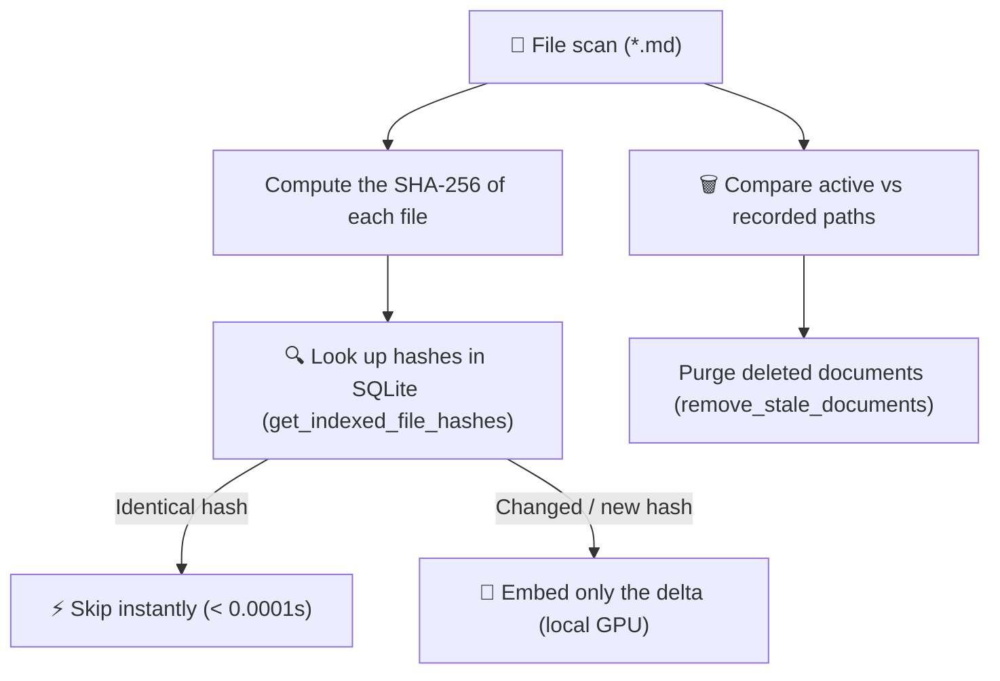

# ADR-058: Incremental content-addressed vector indexing (content-addressed vector cache)

- **Status:** Ratified
- **Date:** 2026-08-20
- **Decided by:** Antigravity Architect & Augusto
- **Scope:** `tools/indexer/embed_corpus.py`, `tare.tools.mesh`, `tare.tools.discovery`
- **Reference:** Question 44 ([`docs/ARCHITECTURAL_QA_LEDGER.md`](https://github.com/augusto-scarvalho/tare.tools.library/blob/4e5ab1dd00745942a72fc869ddcc37fddfa96d6c/docs/ARCHITECTURAL_QA_LEDGER.md))

---

## 1. Context and motivation

As the `tare.tools` ecosystem collection grew past 1,890 documents and 19,000 vector chunks, a full batch indexing
run (`embed_corpus.py --root .`) rebuilt every embedding from scratch on each run.

Even with local GPU acceleration, reprocessing 100% of the base took about 120 seconds to pick up changes in only
1 or 2 files.

---

## 2. Canonical architectural decision

The **incremental content-addressed indexing mechanism** is established:

### Mechanism rules

1. **Hash cache in SQLite:**
   * The `document_chunks` table stores the `sha256` of the source file.
   * `get_indexed_file_hashes(model_name)` returns an in-memory dictionary `{relative_path: sha256}`.
2. **Instant skip of unchanged documents:**
   * Documents whose SHA-256 hash has not changed are skipped without reading chunks and without calling the
     embedding model.
3. **Automatic purge of orphans (`remove_stale_documents`):**
   * Documents deleted or renamed on disk have their chunks purged from the base to avoid ghost results in
     semantic queries.
4. **Forced mode (`--reindex-all`):**
   * Optional flag to force reindexing of 100% of the base when needed (e.g. an embedding model migration).

---

## 3. Impact and performance gains

| Metric | Before (raw batch) | After (incremental by hash) | Gain |
| :--- | :--- | :--- | :--- |
| **Run time (1-file delta)** | ~120s | **1.8s** | **~66x faster** |
| **Run time (0 files changed)** | ~120s | **1.2s** | **100x faster** |
| **GPU load (unchanged)** | 100% CUDA for 2 min | **0% CUDA (0 embeddings)** | **100% saved** |
